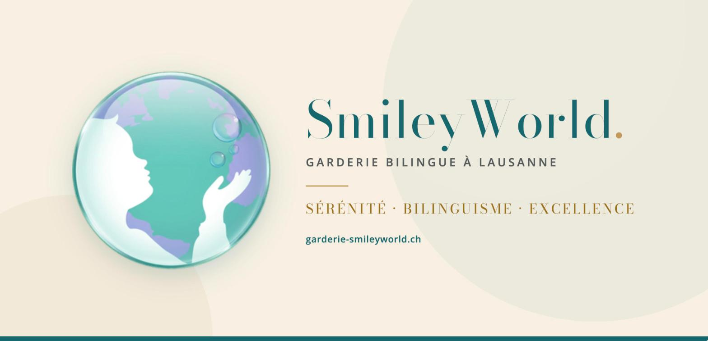

  

<h3 align="center">Garderie bilingue français-anglais au cœur de Lausanne</h3>

  <a href="https://garderie-smileyworld.ch"><b>garderie-smileyworld.ch</b></a>
  &nbsp;·&nbsp; <a href="https://www.instagram.com/smileyworld_daycare/">Instagram</a>
  &nbsp;·&nbsp; <a href="https://www.facebook.com/smileyworld2016/">Facebook</a>
  &nbsp;·&nbsp; <a href="https://www.tiktok.com/@garderiesmileyworld">TikTok</a>

SmileyWorld accueille les enfants de 3 mois jusqu'à l'entrée à l'école, en français et en anglais : un adulte, une langue. Pédagogie active inspirée de Montessori et de Pikler, repas faits maison et sorties quotidiennes.

| | |
|---|---|
| **Adresse** | Route de Chavannes 35/39, 1007 Lausanne |
| **Horaires** | Du lundi au vendredi, 7:00 – 19:00 |
| **Téléphone** | [+41 21 625 85 85](tel:+41216258585) |
| **Groupes** | Nursery (3 à 18 mois) · Trotteurs (18 à 30 mois) · Preschool (dès 30 mois) |

<i>Sérénité. Bilinguisme. Excellence.</i>

